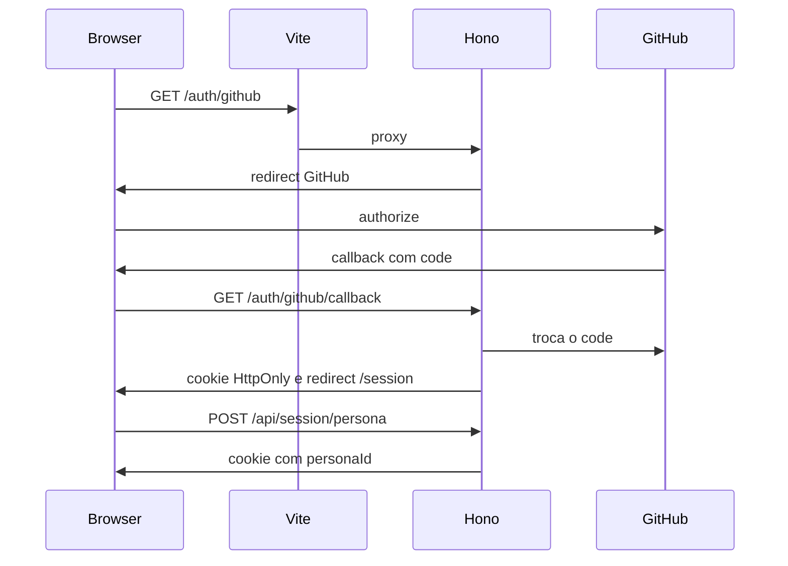

# Autenticação

A pessoa entra com o GitHub. A persona é outra escolha, porque a conta GitHub não é a Marina, o Ricardo ou a Helena.

No computador de desenvolvimento as chaves ficam em `.env.local`. A tela só oferece o GitHub. `POST /auth/test-session` existe com `E2E_SESSION=1`, que o `.env.development` liga e a produção não liga, para a suíte do Playwright não depender do GitHub real.

O cookie é HMAC SHA-256 com `SESSION_SECRET`. Não há token no `localStorage`.
