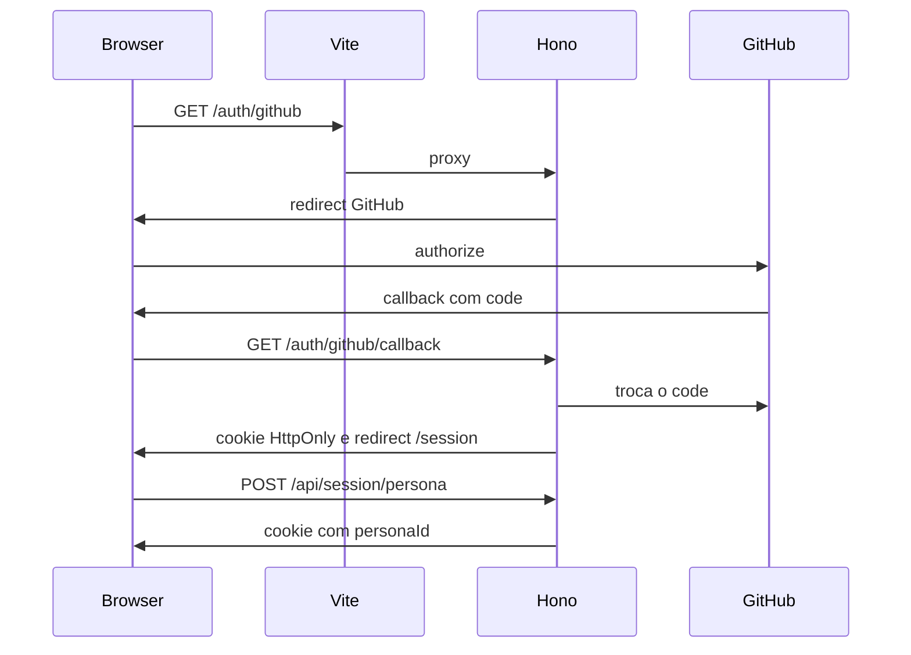

# Autenticação

A pessoa entra com o GitHub. A persona é outra escolha, porque a conta GitHub não é a Marina, o Ricardo ou a Helena.

No computador de desenvolvimento, sem `GITHUB_CLIENT_ID`, a tela oferece **Preview the desk**. Esse caminho só existe com `E2E_SESSION=1`, que o `.env.development` liga e a produção não liga. O Playwright usa `POST /auth/test-session` pelo mesmo motivo: a suíte não depende do GitHub real.

O cookie é HMAC SHA-256 com `SESSION_SECRET`. Não há token no `localStorage`.
