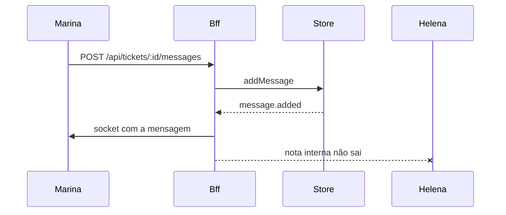

# Mensagens

Uma resposta pública usa `visibility: public`. Uma nota interna usa `internal`. A Helena não recebe a nota nem no JSON.

Se a mensagem é pública e o ticket é dela, o socket da Helena recebe o evento. O rascunho que ela esteja escrevendo continua no estado local do compositor.
