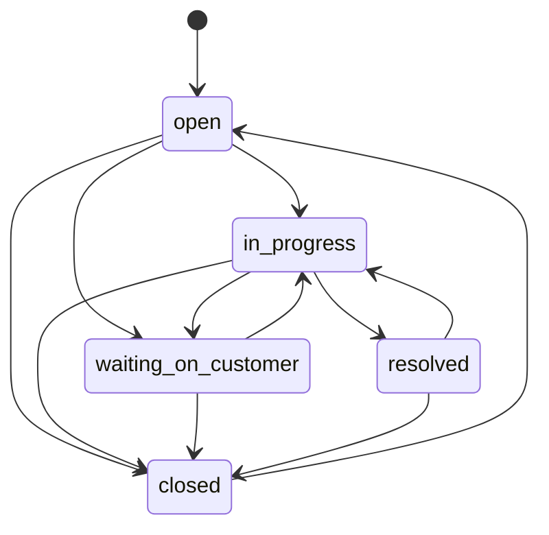

# Ciclo do ticket

Quem atende pode percorrer essas setas. A cliente só percorre `closed` → `open`. Toda mudança exige um motivo com pelo menos três caracteres. O motivo entra em `statusChanges` e aparece na conversa.

Pegar um ticket sem dono emite `ticket.assigned`. Se ele estava `open`, também emite `status.changed` para `in_progress`, com o motivo `Chamado assumido.`.
